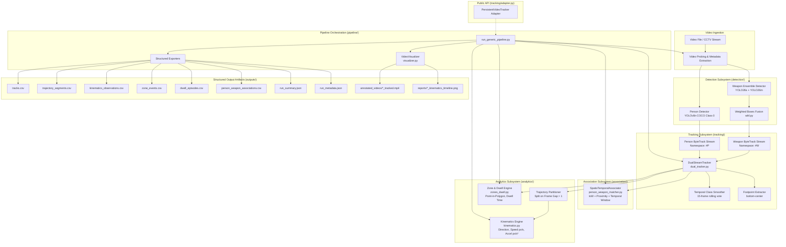
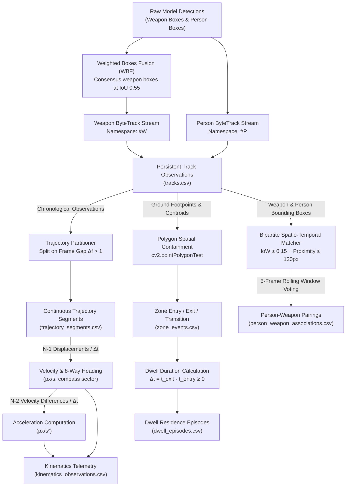
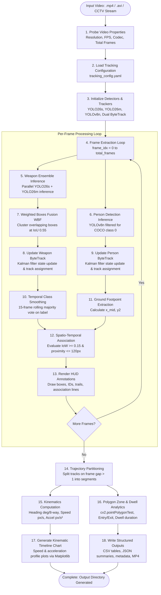
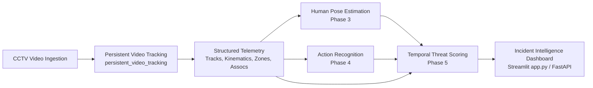

# Persistent Video Tracking

### A YOLO Ensemble and ByteTrack-Based Multi-Object Tracking & Motion Analytics Subsystem for S.W.O.R.D. v2

---

## 1. Project Title and Overview

* **Subsystem Name**: Persistent Video Tracking
* **Parent Architecture**: S.W.O.R.D. v2 (*Surveillance for Weapon Observation using Real-Time Deep Learning*)
* **Repository Path**: [`persistent_video_tracking/`](file:///d:/SWORD_v2_COMPLETE_PROJECT/persistent_video_tracking)
* **Lead Subsystem Engineer**: Aditya Sahani
* **Implementation Language**: Python 3.11.x
* **Core Frameworks**: Ultralytics YOLO, Supervision (ByteTrack), PyTorch, OpenCV, NumPy, Matplotlib, PyYAML

In high-concurrency visual surveillance, object detection models analyze discrete video frames in isolation. While modern object detectors excel at categorizing and localizing objects within an instantaneous image, frame-level detection alone cannot determine:
1. Whether a firearm detected in frame $t$ is the identical physical firearm detected in frame $t+30$.
2. Which specific human actor is carrying, approaching, concealing, or relinquishing a weapon over time.
3. How fast an entity is moving, whether they are accelerating toward a high-security boundary, or whether they are lingering suspiciously near a critical perimeter.

**Persistent Video Tracking** bridges the critical semantic gap between single-frame object localization and temporal threat reasoning. It provides a self-contained, high-performance tracking and motion analytics pipeline that maintains continuous temporal identities for detected people and weapons across surveillance video sequences.

Within the broader S.W.O.R.D. v2 multi-phase surveillance architecture, Persistent Video Tracking ingests video frames, runs a dual-stream detection ensemble, assigns persistent track identifiers through decoupled ByteTrack trackers, calculates gap-aware motion kinematics (direction, velocity, acceleration), detects spatial zone boundaries and dwell episodes, and establishes spatio-temporal person–weapon co-presence associations. These structured outputs serve as direct, deterministic spatial anchors for downstream human pose estimation, action recognition, and temporal threat scoring.

---

## 2. Purpose and Scope

### 2.1 The Need for Temporal Identity in Security Intelligence
Standard CCTV analytics fail when detections flicker or when multiple suspects move concurrently across cluttered scenes. Without persistent multi-object tracking:
* Every frame produces disconnected detections without memory.
* Motion metrics (velocity and acceleration) cannot be computed.
* Perimeter security alarms trigger repeatedly on every frame rather than measuring sustained residence duration.
* Forensic investigators cannot reconstruct continuous movement paths or identify who possessed a weapon at critical moments.

### 2.2 Operational Scope
Persistent Video Tracking addresses video sequences from stationary or mounted CCTV cameras across arbitrary resolutions, frame rates, and scene geometries. Its functional scope covers:
* Multi-model weapon detection ensemble combining YOLO26s and YOLO26m via Weighted Boxes Fusion (WBF).
* Dedicated human body localization via YOLOv8n with ground footpoint extraction.
* Dual-stream decoupled tracking maintaining segregated ID namespaces for weapons (`#W1`, `#W2`, ...) and persons (`#P1`, `#P2`, ...).
* Gap-aware trajectory segmentation that strictly halts velocity and acceleration calculations across tracking voids ($\Delta f > 1$).
* Arbitrary polygon zone entry, transition, exit, and dwell-time analytics.
* Post-tracking bipartite spatio-temporal person–weapon association.
* Export of machine-readable structured artifacts (CSV, JSON, annotated MP4, timeline plots).

---

## 3. Key Features

* **Decoupled Dual-Stream Tracking**: Two completely isolated `supervision.ByteTrack` tracker instances eliminate ID competition between human silhouettes and small handheld weapons.
* **Weighted Boxes Fusion (WBF)**: Fuses bounding boxes from complementary detection models (YOLO26s + YOLO26m) into consensus bounding boxes, reducing boundary jitter and preventing detector dropouts under fast motion blur.
* **Ground Footpoint Anchoring**: Calculates bottom-center footpoint coordinates $\left(\frac{x_1 + x_2}{2}, y_2\right)$ for humans to anchor spatial zone evaluations to physical floor contact rather than head tilt or torso sway.
* **Temporal Class Smoothing**: Applies a 15-frame rolling window of confidence-weighted label voting to eliminate single-frame classification flicker among weapon classes.
* **Gap-Aware Kinematic Segmentation**: Partitions trajectories whenever frame gaps exceed $\Delta f > 1$, strictly enforcing the mathematical relationship $N \to N-1 \to N-2$ and eliminating explosive velocity spikes.
* **Image-Space Heading Categorization**: Classifies instantaneous movement into an 8-way compass vocabulary (`N`, `NE`, `E`, `SE`, `S`, `SW`, `W`, `NW`) with explicit `STATIONARY` tagging below a configurable velocity threshold ($15.0\text{ px/s}$).
* **Perimeter Zone & Dwell Duration Monitoring**: Detects polygon boundary crossings (`ZONE_ENTRY`, `ZONE_EXIT`, `ZONE_TRANSITION`) and verifies strictly non-negative dwell times ($\Delta t_{\text{dwell}} \ge 0$).
* **Spatio-Temporal Person–Weapon Association**: Evaluates Intersection-over-Weapon (IoW), Euclidean proximity, and 5-frame sliding window voting to link weapons to proximate persons without mutating raw track IDs.
* **14-Point Automated Scientific Validator**: Built-in verification suite enforcing 14 mathematical, architectural, and data integrity invariants on completed runs.
* **Modular Integration Adapter**: [`PersistentVideoTracker`](file:///d:/SWORD_v2_COMPLETE_PROJECT/persistent_video_tracking/tracking/adapter.py) provides a standardized programmatic Python API for frame-by-frame consumption.

---

## 4. System Architecture

The module architecture decouples detection, tracking, spatial analytics, and visualization into isolated, single-responsibility components coordinated by the pipeline orchestrator.

### Module Architecture Diagram



### Track Data Flow Diagram

The following diagram tracks how single-frame bounding box detections transform step-by-step into persistent tracking states, continuous trajectory segments, gap-aware kinematics, zone events, and spatio-temporal associations:



---

## 5. End-to-End Pipeline Flowchart

The following flowchart documents the chronological execution flow from the ingestion of an input video to the generation of structured artifacts:



---

## 6. Module and Directory Structure

The repository structure cleanly isolates core runtime modules, unit tests, configurations, benchmark outputs, and historical research scripts:

```
persistent_video_tracking/
│
├── __init__.py                                # Package root: exports 23 public classes and functions
├── README.md                                  # Comprehensive technical manual (this document)
├── requirements.txt                           # Pinned runtime dependencies
├── .gitignore                                 # Git exclusions for weights, runs, and caches
│
├── config/                                    # Production and Benchmark Configurations
│   ├── tracking_config.yaml                   # Central master tracking and analytics configuration
│   └── test_zone_config.yaml                  # Multi-polygon security zone benchmark configuration
│
├── detection/                                 # Multi-Model Detection Subsystem
│   ├── __init__.py                            # Detection package exports
│   ├── weapon_ensemble.py                     # YOLO26s + YOLO26m ensemble detector
│   ├── person_detector.py                     # YOLOv8n COCO Person Detector (Class 0, Footpoint extraction)
│   └── wbf.py                                 # Standalone Weighted Boxes Fusion (WBF) implementation
│
├── tracking/                                  # Decoupled Dual ByteTrack Tracking Stream
│   ├── __init__.py                            # Tracking package exports
│   ├── adapter.py                             # Public API adapter: PersistentVideoTracker, FrameTrackingResult
│   ├── dual_tracker.py                        # Isolated weapon & person ByteTrack instances + class smoother
│   └── schema.py                              # Canonical TrackObservation dataclass & column specifications
│
├── analytics/                                 # Motion Kinematics, Trajectory & Zone Engine
│   ├── __init__.py                            # Analytics package exports
│   ├── kinematics.py                          # Gap-aware trajectory segmentation, velocity & acceleration
│   └── zones_dwell.py                         # Polygon spatial containment, transitions, and dwell times
│
├── association/                               # Spatio-Temporal Association Engine
│   ├── __init__.py                            # Association package exports
│   └── person_weapon_matcher.py               # Bipartite IoW + proximity matching (raw IDs preserved)
│
├── visualization/                             # Security HUD Overlay & Timeline Visualizer
│   ├── __init__.py                            # Visualization exports
│   └── visualizer.py                          # Security HUD renderer & kinematics timeseries plotter
│
├── pipeline/                                  # Orchestration & Validation Pipeline
│   ├── __init__.py                            # Pipeline exports with lazy circular-import protection
│   ├── run_generic_pipeline.py                # Main CLI and programmatic pipeline entry point
│   ├── validate_pipeline.py                   # Automated 14-point scientific invariant validator
│   └── test_modules.py                        # In-package unit tests for core algorithms
│
├── tests/                                     # Top-Level Test Package
│   ├── __init__.py                            # Test package marker
│   └── test_modules.py                        # Standard unit test suite
│
├── examples/                                  # Example Utilities & Video Generators
│   ├── create_test_video.py                   # Dynamic synthetic CCTV video generator
│   └── README.md                              # Instructions for generating and testing synthetic feeds
│
├── outputs/                                   # Verified Benchmark Run Outputs
│   ├── README.md                              # Quantitative results documentation and schema index
│   ├── sample_video_01/                       # Benchmark outputs for sample video 01 (14/14 PASS)
│   ├── sample_video_02/                       # Benchmark outputs for sample video 02 (14/14 PASS)
│   ├── sample_video_03/                       # Benchmark outputs for sample video 03 (14/14 PASS)
│   └── sample_test_video/                     # Benchmark outputs for synthetic test video (14/14 PASS)
│
├── dataset/                                   # Historical Datasets and Validation Media
│   ├── outputs/                               # Frozen historical reports and tracking results
│   ├── processed/                             # Processed sample frames and test clips
│   ├── raw/                                   # Raw test videos and annotations
│   ├── real_input/                            # External verification test input
│   └── real_output/                           # External verification tracking output
│
├── sample_test_video.mp4                      # Controlled 60-frame synthetic CCTV video fixture
├── output_tracked.mp4                         # Historical tracked prototype output fixture
├── tracker.py                                 # Historical ByteTrack single-stream prototype
├── run_tracking_pipeline.py                   # Historical batch-run dataset tracking script
├── audit_dataset.py                           # Historical dataset annotation integrity auditor
├── mock_mendeley.py                           # Historical synthetic annotation generator
├── download_sample.py                         # Sample download script
├── download_mendeley.py                       # Mendeley dataset download script
├── temporal_class_smoother.py                 # Historical rolling-window class smoothing validator
├── trajectory_analysis.py                     # Historical raw trajectory segmentation auditor
├── trajectory_preprocessing.py                # Historical trajectory gap-aware preprocessor
├── trajectory_quality_audit.py                # Historical trajectory data quality auditor
└── velocity_analysis.py                       # Historical pixel velocity distribution analyzer
```

### Architectural Classification of Files

| Category | Description | Files / Folders |
| :--- | :--- | :--- |
| **Core Runtime Code** | Modules required for production tracking and analytics | `config/`, `detection/`, `tracking/`, `analytics/`, `association/`, `visualization/`, `pipeline/run_generic_pipeline.py`, `tracking/adapter.py` |
| **Test & Validation Code** | Automated test suites and invariant validation | `tests/test_modules.py`, `pipeline/test_modules.py`, `pipeline/validate_pipeline.py` |
| **Examples & Utilities** | Synthetic CCTV video generator and usage documentation | `examples/create_test_video.py`, `examples/README.md` |
| **Benchmark Outputs** | Immutable validation runs evaluated across 14 invariants | `outputs/sample_video_01/`, `outputs/sample_video_02/`, `outputs/sample_video_03/`, `outputs/sample_test_video/` |
| **Historical Evidence** | Research scripts and early prototypes preserved for reproducibility | `tracker.py`, `run_tracking_pipeline.py`, `audit_dataset.py`, `trajectory_*.py`, `velocity_analysis.py`, `dataset/` |
| **External Dependencies** | Model checkpoints managed outside Git | `weights/yolo26s_best.pt`, `weights/yolo26m_best.pt`, `yolov8n.pt` |

---

## 7. Technical Workflow

The 18-step processing sequence implemented in Persistent Video Tracking operates as follows:

| Step | Component | Purpose & Description | Input | Output | Source File | Downstream Consumer | Status |
| :---: | :--- | :--- | :--- | :--- | :--- | :--- | :---: |
| **1** | **Video Input** | Ingest arbitrary surveillance video or RTSP stream | Video file path or stream URI | Video handle (`cv2.VideoCapture`) | [`pipeline/run_generic_pipeline.py`](file:///d:/SWORD_v2_COMPLETE_PROJECT/persistent_video_tracking/pipeline/run_generic_pipeline.py#L90) | Step 2 | **Implemented** |
| **2** | **Metadata Probing** | Probe native resolution, dynamic FPS, total frame count, and FourCC codec | Video handle | `fps` ($float$), `width`, `height`, `total_frames` | [`pipeline/run_generic_pipeline.py`](file:///d:/SWORD_v2_COMPLETE_PROJECT/persistent_video_tracking/pipeline/run_generic_pipeline.py#L96-L100) | Steps 4, 10, 11, 15 | **Implemented** |
| **3** | **Frame Extraction** | Sequentially read decoded video frames as NumPy BGR arrays | Video handle | BGR Image Array $(H, W, 3)$ | [`pipeline/run_generic_pipeline.py`](file:///d:/SWORD_v2_COMPLETE_PROJECT/persistent_video_tracking/pipeline/run_generic_pipeline.py#L125) | Steps 4, 5, 17 | **Implemented** |
| **4** | **Weapon Detection Ensemble** | Independent parallel inference using YOLO26s (fast) and YOLO26m (deep) across 10 weapon classes | BGR Image Array | Two sets of candidate boxes, scores, and class labels | [`detection/weapon_ensemble.py`](file:///d:/SWORD_v2_COMPLETE_PROJECT/persistent_video_tracking/detection/weapon_ensemble.py#L85-L140) | Step 6 | **Implemented** |
| **5** | **Person Detection** | Localize human bodies using YOLOv8n filtered exclusively for COCO class 0 (`person`) | BGR Image Array | Candidate person bounding boxes and confidence scores | [`detection/person_detector.py`](file:///d:/SWORD_v2_COMPLETE_PROJECT/persistent_video_tracking/detection/person_detector.py#L50-L88) | Step 7 | **Implemented** |
| **6** | **Weighted Boxes Fusion (WBF)** | Compute confidence-weighted consensus boxes at IoU 0.55 to resolve boundary jitter | Candidate weapon boxes from Step 4 | Single unified `sv.Detections` object for weapons | [`detection/wbf.py`](file:///d:/SWORD_v2_COMPLETE_PROJECT/persistent_video_tracking/detection/wbf.py#L48-L230) | Step 7 | **Implemented** |
| **7** | **Dual ByteTrack Tracking** | Update two isolated ByteTrack Kalman filter trackers to prevent person–weapon ID competition | Fused weapon detections & person detections | Active track states for weapon and person streams | [`tracking/dual_tracker.py`](file:///d:/SWORD_v2_COMPLETE_PROJECT/persistent_video_tracking/tracking/dual_tracker.py#L65-L135) | Step 8 | **Implemented** |
| **8** | **Persistent Track ID Assignment** | Assign immutable numeric track IDs segregated by stream (`object_type="weapon"` vs `"person"`) | ByteTrack track states | Stream-segregated persistent Track IDs (`int`) | [`tracking/dual_tracker.py`](file:///d:/SWORD_v2_COMPLETE_PROJECT/persistent_video_tracking/tracking/dual_tracker.py#L100-L125) | Steps 9, 14, 16 | **Implemented** |
| **9** | **Temporal Class Smoothing** | Maintain 15-frame rolling window of weapon classifications to eliminate label flicker | Instantaneous weapon class labels & confidences | Majority-voted weapon class string | [`tracking/dual_tracker.py`](file:///d:/SWORD_v2_COMPLETE_PROJECT/persistent_video_tracking/tracking/dual_tracker.py#L140-L165) | Steps 13, 17, 18 | **Implemented** |
| **10** | **Footpoint Extraction** | Compute bottom-center ground coordinates $(x_{\text{mid}}, y_2)$ for tracked persons | Person bounding boxes $[x_1, y_1, x_2, y_2]$ | Ground footpoint $(x, y)$ coordinates | [`tracking/dual_tracker.py`](file:///d:/SWORD_v2_COMPLETE_PROJECT/persistent_video_tracking/tracking/dual_tracker.py#L120) | Steps 14, 15, 17 | **Implemented** |
| **11** | **Trajectory Segmentation** | Split track observations into continuous segments on temporal voids ($\Delta f > 1$) | Chronological track observations | List of continuous `TrajectorySegment` objects | [`analytics/kinematics.py`](file:///d:/SWORD_v2_COMPLETE_PROJECT/persistent_video_tracking/analytics/kinematics.py#L45-L105) | Step 12 | **Implemented** |
| **12** | **Direction Estimation** | Calculate instantaneous displacement vector and map heading $\theta$ to 8 compass sectors | Centroid displacement $(\Delta x, \Delta y)$ | Heading degrees ($0^\circ - 360^\circ$) & 8-way compass label | [`analytics/kinematics.py`](file:///d:/SWORD_v2_COMPLETE_PROJECT/persistent_video_tracking/analytics/kinematics.py#L110-L140) | Step 13 | **Implemented** |
| **13** | **Velocity & Acceleration Calculation** | Compute pixel speed ($px/s$) across $N-1$ steps and acceleration ($px/s^2$) across $N-2$ steps | Continuous trajectory segments & video FPS | Velocity & acceleration vectors per valid step | [`analytics/kinematics.py`](file:///d:/SWORD_v2_COMPLETE_PROJECT/persistent_video_tracking/analytics/kinematics.py#L145-L210) | Steps 17, 18 | **Implemented** |
| **14** | **Zone Boundary Detection** | Test entity anchors against polygon regions via `cv2.pointPolygonTest` | Footpoints (persons) / Centroids (weapons) & polygons | `ZONE_ENTRY`, `ZONE_EXIT`, `ZONE_TRANSITION` events | [`analytics/zones_dwell.py`](file:///d:/SWORD_v2_COMPLETE_PROJECT/persistent_video_tracking/analytics/zones_dwell.py#L110-L200) | Step 15 | **Implemented** |
| **15** | **Dwell-Time Calculation** | Calculate continuous residence duration ($\Delta t = t_{\text{exit}} - t_{\text{entry}} \ge 0$) | Zone occupancy timestamps | `DwellEpisode` records ($duration \ge 0$) | [`analytics/zones_dwell.py`](file:///d:/SWORD_v2_COMPLETE_PROJECT/persistent_video_tracking/analytics/zones_dwell.py#L205-L260) | Step 18 | **Implemented** |
| **16** | **Person–Weapon Association** | Evaluate IoW ($\ge 0.15$), Euclidean proximity ($\le 120\text{ px}$), and 5-frame sliding window | Co-occurring person and weapon tracks | `AssociationRecord` linkages with confidence score | [`association/person_weapon_matcher.py`](file:///d:/SWORD_v2_COMPLETE_PROJECT/persistent_video_tracking/association/person_weapon_matcher.py#L60-L160) | Steps 17, 18 | **Implemented** |
| **17** | **Visualization & HUD Rendering** | Render bounding boxes, IDs, trails, association lines, and zone boundaries onto frames | Video frames, tracks, associations, zones | Annotated MP4 video & Matplotlib timeseries plots | [`visualization/visualizer.py`](file:///d:/SWORD_v2_COMPLETE_PROJECT/persistent_video_tracking/visualization/visualizer.py#L40-L190) | Step 18 | **Implemented** |
| **18** | **Structured Output Generation** | Export complete run data to standardized CSV and JSON formats | Accumulated tracks, kinematics, zones, assocs | 8 CSV/JSON artifact files under `outputs/<video>/` | [`pipeline/run_generic_pipeline.py`](file:///d:/SWORD_v2_COMPLETE_PROJECT/persistent_video_tracking/pipeline/run_generic_pipeline.py#L350-L460) | External Systems | **Implemented** |

---

## 8. Mathematical Foundations

All mathematical calculations operate strictly in **2D image coordinate space** ($+X$ right, $+Y$ down, origin $(0, 0)$ at top-left corner). Converting image-space measurements into real-world SI metric units ($\text{m/s}$) requires camera calibration and a 4-point planar homography matrix transformation, which is intentionally decoupled from this module.

### 8.1 Centroids and Ground Footpoint
For a bounding box $B = [x_1, y_1, x_2, y_2]$:
* **Bounding Box Center**:
  $$c_x = \frac{x_1 + x_2}{2}, \quad c_y = \frac{y_1 + y_2}{2}$$
* **Ground Footpoint Anchor** (for human ground contact):
  $$\text{footpoint} = \left(\frac{x_1 + x_2}{2}, y_2\right)$$

### 8.2 Weighted Boxes Fusion (WBF)
Given predictions from $M$ detection models (YOLO26s with weight $w_1 = 1.0$, YOLO26m with weight $w_2 = 1.1$), overlapping candidate bounding boxes for the same class are clustered at IoU threshold $\theta_{\text{IoU}} = 0.55$. The consensus fused coordinates $x_{i}^{\text{fused}}$ and fused confidence score $c^{\text{fused}}$ are computed as:

$$x_{i}^{\text{fused}} = \frac{\sum_{m=1}^{M} w_m \cdot c_m \cdot x_{i}^{(m)}}{\sum_{m=1}^{M} w_m \cdot c_m}, \quad c^{\text{fused}} = \frac{\sum_{m=1}^{M} w_m \cdot c_m}{\sum_{m=1}^{M} w_m}$$

### 8.3 Gap-Aware Kinematic Segmentation & Differentials
Standard finite differencing directly across detection voids ($\Delta f > 1$) creates artificial, explosive velocity spikes. To prevent this, the trajectory of each track is partitioned into continuous segments:

$$\text{Segment Break Trigger}: \quad \Delta f_k = f_k - f_{k-1} > 1$$

Within any continuous segment containing $N$ consecutive observations at native video frame rate $\text{FPS}$:
* **Pixel Displacement**:
  $$\Delta x = c_x(k) - c_x(k-1), \quad \Delta y = c_y(k) - c_y(k-1)$$
* **Time Delta**:
  $$\Delta t = \frac{\Delta f}{\text{FPS}} = \frac{1}{\text{FPS}} \quad (\text{since } \Delta f = 1)$$
* **Pixel Velocity**: Exactly $N-1$ velocity calculations per segment:
  $$v_x = \frac{\Delta x}{\Delta t} = \Delta x \cdot \text{FPS}, \quad v_y = \frac{\Delta y}{\Delta t} = \Delta y \cdot \text{FPS}$$
  $$\|v\| = \sqrt{v_x^2 + v_y^2} \quad (\text{px/s})$$
* **Pixel Acceleration**: Exactly $N-2$ acceleration calculations per segment:
  $$a_x = \frac{v_x(k) - v_x(k-1)}{\Delta t}, \quad a_y = \frac{v_y(k) - v_y(k-1)}{\Delta t}$$
  $$\|a\| = \sqrt{a_x^2 + a_y^2} \quad (\text{px/s}^2)$$

$$\mathbf{The\ Mathematical\ Relationship}:\quad N\text{ Observations} \longrightarrow (N-1)\text{ Velocities} \longrightarrow (N-2)\text{ Accelerations}$$

### 8.4 Heading and Stationary State Tagging
* **Instantaneous Heading Angle**:
  $$\theta = \left(\text{atan2}(\Delta y, \Delta x) \cdot \frac{180}{\pi}\right) \pmod{360^\circ}$$
* **Compass Sector Mapping**: Angular headings are binned into 8 compass sectors centered at multiples of $45^\circ$:
  * `E`: $[337.5^\circ, 360^\circ) \cup [0^\circ, 22.5^\circ)$
  * `SE`: $[22.5^\circ, 67.5^\circ)$
  * `S`: $[67.5^\circ, 112.5^\circ)$
  * `SW`: $[112.5^\circ, 157.5^\circ)$
  * `W`: $[157.5^\circ, 202.5^\circ)$
  * `NW`: $[202.5^\circ, 247.5^\circ)$
  * `N`: $[247.5^\circ, 292.5^\circ)$
  * `NE`: $[292.5^\circ, 337.5^\circ)$
* **Stationary Tagging**: If instantaneous pixel speed $\|v\| \le 15.0\text{ px/s}$, the direction label is explicitly assigned to `STATIONARY`.

### 8.5 Spatial Zone Containment and Dwell Duration
For a 2D polygon zone defined by vertices $P = [(x_1, y_1), (x_2, y_2), \dots, (x_m, y_m)]$, spatial containment is evaluated using `cv2.pointPolygonTest`:

$$\text{test}(P, (x, y)) \begin{cases} > 0 & \text{inside zone} \\ = 0 & \text{on boundary} \\ < 0 & \text{outside zone} \end{cases}$$

* **Dwell Residence Duration**: Evaluated across entry timestamp $t_{\text{entry}}$ and exit timestamp $t_{\text{exit}}$:
  $$\Delta t_{\text{dwell}} = t_{\text{exit}} - t_{\text{entry}} \ge 0.0\text{ seconds}$$

### 8.6 Spatio-Temporal Person–Weapon Association
Geometric association between a weapon bounding box $B_W$ and a person bounding box $B_P$ evaluates:
* **Intersection-over-Weapon (IoW)**:
  $$\text{IoW} = \frac{\text{Area}(B_W \cap B_P)}{\text{Area}(B_W)} \in [0.0, 1.0]$$
* **Centroid Euclidean Distance**:
  $$d_{\text{euc}} = \sqrt{(c_x^W - c_x^P)^2 + (c_y^W - c_y^P)^2} \quad (\text{pixels})$$
* **Instantaneous Association Score**:
  $$S = \begin{cases} 0.6 \cdot \text{IoW} + 0.4 \cdot \left(1.0 - \frac{d_{\text{euc}}}{d_{\text{max}}}\right) & \text{if } \text{IoW} \ge 0.15 \text{ or } d_{\text{euc}} \le d_{\text{max}} \\ 0.0 & \text{otherwise} \end{cases}$$
* **Temporal Window Voting**: Association statuses (`ASSOCIATED` vs `UNASSOCIATED`) are accumulated across a 5-frame rolling window. An association is confirmed only when the rolling consensus score meets or exceeds the activation threshold ($0.35 - 0.40$).

> **FORENSIC AND ETHICAL LIMITATION:**  
> Geometric association indicates solely that a detected weapon is proximate to a tracked person in the 2D image projection plane. Proximity does **not** prove physical ownership, legal possession, criminal intent, or active threat. Downstream modules must evaluate physical grip and temporal context before raising an operational alarm.

---

## 9. Installation and Environment Setup

### 9.1 Environment Prerequisites
* **Operating System**: Windows 10/11 (or Linux / macOS)
* **Python**: Verified on Python **3.11.6** (Python $\ge 3.10$ supported)
* **Execution Hardware**: Standard x86_64 CPU (CPU execution fully verified; optional CUDA acceleration supported when available)

### 9.2 Setup in Windows PowerShell

Execute the following commands from the root of the project:

```powershell
# 1. Navigate to the project root
cd D:\SWORD_v2_COMPLETE_PROJECT

# 2. Create a virtual environment
python -m venv .venv

# 3. Activate the virtual environment
.\.venv\Scripts\Activate.ps1

# 4. Upgrade pip and wheel
python -m pip install --upgrade pip setuptools wheel

# 5. Install dependencies from the verified requirements manifest
pip install -r persistent_video_tracking\requirements.txt
```

### 9.3 Verified Dependencies Manifest (`requirements.txt`)
The module dependencies are strictly pinned in [`persistent_video_tracking/requirements.txt`](file:///d:/SWORD_v2_COMPLETE_PROJECT/persistent_video_tracking/requirements.txt):

```
ultralytics>=8.3.0
supervision>=0.18.0
opencv-python>=4.8.0
numpy>=1.24.0
matplotlib>=3.7.0
pyyaml>=6.0
torch>=2.0.0
torchvision>=0.15.0
```

---

## 10. Model Weights and Configuration

Persistent Video Tracking requires three model checkpoint files. Model paths are dynamically resolved via [`resolve_model_path()`](file:///d:/SWORD_v2_COMPLETE_PROJECT/persistent_video_tracking/detection/weapon_ensemble.py#L29-L47), checking relative to the current working directory, the package directory, and the project root.

### Expected Model Checkpoint Locations

| Model Identifier | File Name | Expected Location | Size | Architecture / Description |
| :--- | :--- | :--- | :---: | :--- |
| `weapon_s` | `yolo26s_best.pt` | `weights/yolo26s_best.pt` | ~60.2 MB | Custom fine-tuned 10-class YOLO26s weapon detector |
| `weapon_m` | `yolo26m_best.pt` | `weights/yolo26m_best.pt` | ~131.3 MB | Custom fine-tuned 10-class YOLO26m weapon detector |
| `person` | `yolov8n.pt` | `yolov8n.pt` (Project Root) | ~6.5 MB | Standard Ultralytics YOLOv8n COCO model (Class 0: `person`) |

### Missing Checkpoints Handling
If a model file is missing:
1. `PersonDetector` will automatically download `yolov8n.pt` from Ultralytics release assets upon initialization if not found locally.
2. If `yolo26s_best.pt` or `yolo26m_best.pt` are missing, [`WeaponEnsembleDetector`](file:///d:/SWORD_v2_COMPLETE_PROJECT/persistent_video_tracking/detection/weapon_ensemble.py) raises an explicit `FileNotFoundError` indicating the exact candidate paths searched. Checkpoints should be placed inside [`weights/`](file:///d:/SWORD_v2_COMPLETE_PROJECT/weights).

---

## 11. Running the Pipeline

The pipeline is invoked through [`persistent_video_tracking.pipeline.run_generic_pipeline`](file:///d:/SWORD_v2_COMPLETE_PROJECT/persistent_video_tracking/pipeline/run_generic_pipeline.py).

### CLI Argument Specification

| Argument | Type | Default | Description |
| :--- | :---: | :--- | :--- |
| `--source` | `str` | *Required* | Path to input video file (e.g. `.mp4`, `.avi`, `.mov`) |
| `--config` | `str` | `None` | Path to YAML config (defaults to `persistent_video_tracking/config/tracking_config.yaml`) |
| `--output_dir` | `str` | `None` | Base directory for outputs (defaults to `persistent_video_tracking/outputs`) |
| `--device` | `str` | `None` | Hardware device override (`cpu` or `cuda`) |
| `--no_video` | flag | `False` | Skip rendering annotated video for maximum processing throughput |
| `--max_frames` | `int` | `None` | Process only the first $M$ frames (ideal for smoke testing) |

### 11.1 Run a Sample Benchmark Video

```powershell
# Execute on sample_video_01 with default configuration
python -m persistent_video_tracking.pipeline.run_generic_pipeline `
    --source persistent_video_tracking/dataset/raw/videos/sample/sample_video_01.mp4 `
    --max_frames 50
```

### 11.2 Run with Custom Output Directory and Device Selection

```powershell
# Execute on sample_video_02, saving outputs to custom folder on CPU
python -m persistent_video_tracking.pipeline.run_generic_pipeline `
    --source persistent_video_tracking/dataset/raw/videos/sample/sample_video_02.mp4 `
    --output_dir persistent_video_tracking/outputs/custom_evaluation `
    --device cpu `
    --max_frames 100
```

### 11.3 Fast Batch Processing (Headless, No Video Rendering)

```powershell
# Skip video annotation to compute pure structured telemetry at maximum speed
python -m persistent_video_tracking.pipeline.run_generic_pipeline `
    --source persistent_video_tracking/sample_test_video.mp4 `
    --no_video
```

### 11.4 Full Video Execution (Unrestricted)

```powershell
# Process complete video without frame limits
python -m persistent_video_tracking.pipeline.run_generic_pipeline `
    --source persistent_video_tracking/sample_test_video.mp4
```

### Expected Console Output
```text
======================================================================
  S.W.O.R.D. v2 — PERSISTENT VIDEO TRACKING PIPELINE
  Run ID: run_20261102_005435_3b5639
  Source: persistent_video_tracking/sample_test_video.mp4
======================================================================
[Video Source] Resolution: 1280x720 | FPS: 20.00 | Frames: 60 | Duration: 3.00s
[WeaponEnsemble] Loading YOLO26s from 'D:\SWORD_v2_COMPLETE_PROJECT\weights\yolo26s_best.pt' (device=cpu)...
[WeaponEnsemble] Loading YOLO26m from 'D:\SWORD_v2_COMPLETE_PROJECT\weights\yolo26m_best.pt' (device=cpu)...
[WeaponEnsemble] Ready: 2 models (YOLO26s, YOLO26m), weights=[1.0, 1.1], conf_thr=0.25, iou_thr=0.55, mode=wbf
[PersonDetector] Loading YOLOv8n from 'D:\SWORD_v2_COMPLETE_PROJECT\yolov8n.pt' (device=cpu)...
[PersonDetector] Ready: class_id=0 ('person'), conf_thr=0.35
[ZoneDwellEngine] Loaded 2 configured zones.

[Processing] Starting frame-by-frame analysis on sample_test_video.mp4...
  [sample_test_video] Frame 40/40 (100.0%) | 2.2 FPS | Weapons: 1 IDs | Obs: 40
[Annotated Video] Saved to: persistent_video_tracking/outputs\sample_test_video\annotated_videos\sample_test_video_tracked.mp4

[Analytics] Computing trajectory segmentation, kinematics, zones, and dwell...

======================================================================
  PHASE 2 GENERIC PIPELINE RUN COMPLETE
  Processed Frames: 40/60 (2.1 FPS)
  Weapon Tracks: 1 | Person Tracks: 0
  Trajectory Segments: 1 (1 Valid N>=5)
  Kinematics Steps: 39 (38 Acceleration)
  Associated Pairs: 0
  Outputs saved to: persistent_video_tracking/outputs\sample_test_video
======================================================================
```

---

## 12. Custom Video Execution & Synthetic Test Generator

### 12.1 Running Arbitrary External MP4 Videos
The pipeline accepts any compatible video format (`.mp4`, `.avi`, `.mov`, `.mkv`). Source frame rate, resolution, and dimensions are dynamically probed:

```powershell
python -m persistent_video_tracking.pipeline.run_generic_pipeline `
    --source D:\Path\To\External_CCTV_Camera_01.mp4 `
    --output_dir persistent_video_tracking/outputs/cctv_c1
```

### 12.2 Generating Synthetic Surveillance Test Videos
The module provides a standalone synthetic video generator ([`examples/create_test_video.py`](file:///d:/SWORD_v2_COMPLETE_PROJECT/persistent_video_tracking/examples/create_test_video.py)) that produces a controlled 60-frame MP4 video with sinusoidal target motion for functional testing:

```powershell
# Generate default synthetic test video (sample_test_video.mp4)
python persistent_video_tracking\examples\create_test_video.py
```

---

## 13. Generated Outputs and Data Schemas

Every processed video produces a structured output directory organized as follows:

```
outputs/<video_stem>/
├── annotated_videos/
│   └── <video_stem>_tracked.mp4               # Annotated video with HUD overlays
├── tracking/
│   └── tracks.csv                             # Raw ByteTrack tracking observations
├── trajectories/
│   └── trajectory_segments.csv                # Continuous segmented trajectory spans
├── kinematics/
│   └── kinematics_observations.csv            # Direction, velocity, and acceleration
├── zones/
│   ├── zone_events.csv                        # Chronological entry/exit/transition events
│   └── dwell_episodes.csv                     # Sustained residence duration records
├── associations/
│   └── person_weapon_associations.csv         # Person–weapon proximity pairings
└── reports/
    ├── run_metadata.json                      # Full provenance, parameters, and environment
    ├── run_summary.json                       # Aggregated quantitative metrics
    └── <video_stem>_kinematics_timeline.png   # Kinematic velocity and acceleration plots
```

### Detailed Output Schemas

#### 1. `tracking/tracks.csv`
Contains the raw ByteTrack state history for all tracked entities on every frame:

| Column | Type | Unit | Description |
| :--- | :---: | :---: | :--- |
| `video_name` | `string` | — | Basename of the source video file |
| `frame_id` | `integer` | frames | 0-indexed sequential video frame number |
| `timestamp_seconds` | `float` | seconds | Elapsed video presentation timestamp ($\frac{\text{frame\_id}}{\text{FPS}}$) |
| `object_type` | `string` | — | Entity stream: `"weapon"` or `"person"` |
| `track_id` | `integer` | — | Persistent tracker identifier assigned by ByteTrack |
| `class_name` | `string` | — | Smoothed weapon class label or `"person"` |
| `confidence` | `float` | $[0.0, 1.0]$ | Detection / tracking confidence score |
| `x1`, `y1`, `x2`, `y2` | `float` | pixels | Bounding box corner coordinates |
| `center_x`, `center_y` | `float` | pixels | Center centroid coordinates |
| `bottom_center_x`, `bottom_center_y` | `float` | pixels | Ground footpoint anchor coordinates |

#### 2. `trajectories/trajectory_segments.csv`
Logs continuous trajectory sub-segments partitioned whenever detection gaps exceed $\Delta f > 1$:

| Column | Type | Unit | Description |
| :--- | :---: | :---: | :--- |
| `segment_id` | `string` | — | Unique segment key (e.g. `sample_video_01_weapon_track_1_seg_0001`) |
| `video_name` | `string` | — | Source video file name |
| `object_type` | `string` | — | Entity stream: `"weapon"` or `"person"` |
| `track_id` | `integer` | — | Source ByteTrack identifier |
| `class_name` | `string` | — | Classified object label |
| `observations_count` | `integer` | count | Total consecutive observation frames $N$ in this segment |
| `start_frame`, `end_frame`| `integer` | frames | Frame boundaries of the continuous observation span |
| `duration_seconds` | `float` | seconds | Temporal span ($\frac{\text{end\_frame} - \text{start\_frame}}{\text{FPS}}$) |
| `is_valid_motion` | `boolean` | — | `True` if segment observation count $N \ge 5$ observations |
| `total_path_length_px` | `float` | pixels | Cumulative path distance traversed along the trajectory |
| `displacement_px` | `float` | pixels | Straight-line Euclidean distance between start and end |

#### 3. `kinematics/kinematics_observations.csv`
Contains frame-by-frame motion telemetry evaluated strictly within continuous segments:

| Column | Type | Unit | Description |
| :--- | :---: | :---: | :--- |
| `segment_id` | `string` | — | Foreign key to parent `trajectory_segments.csv` |
| `from_frame`, `to_frame` | `integer` | frames | Consecutive frame indices ($\text{to\_frame} - \text{from\_frame} = 1$) |
| `dt_s` | `float` | seconds | Time difference $\Delta t = \frac{1}{\text{FPS}}$ |
| `dx_px`, `dy_px` | `float` | pixels | Centroid displacement components in image coordinates |
| `vx_px_s`, `vy_px_s` | `float` | px/s | Velocity components ($\frac{\Delta x}{\Delta t}, \frac{\Delta y}{\Delta t}$) |
| `speed_px_s` | `float` | px/s | Instantaneous scalar speed ($\sqrt{v_x^2 + v_y^2}$) |
| `is_stationary` | `boolean` | — | `True` if scalar speed $\le 15.0\text{ px/s}$ |
| `heading_deg` | `float` | degrees | Direction angle $\theta \in [0^\circ, 360^\circ)$ ($0^\circ = \text{East}$) |
| `direction_8way` | `string` | — | Compass label (`N`, `NE`, `E`, `SE`, `S`, `SW`, `W`, `NW`, `STATIONARY`) |
| `ax_px_s2`, `ay_px_s2` | `float` | $\text{px/s}^2$ | Acceleration vector components (empty string on step 1) |
| `acceleration_px_s2` | `float` | $\text{px/s}^2$ | Scalar acceleration magnitude ($\sqrt{a_x^2 + a_y^2}$) |

#### 4. `zones/zone_events.csv`
Chronological event log of perimeter polygon boundary crossings:

| Column | Type | Description |
| :--- | :---: | :--- |
| `frame_id`, `timestamp_seconds` | `int`, `float` | Temporal position when the event occurred |
| `object_type`, `track_id` | `string`, `int` | Stream and ID of the entity crossing the boundary |
| `from_zone`, `to_zone` | `string` | Previous zone and entered zone (`"outside"` if outside) |
| `event` | `string` | Event category: `"ZONE_ENTRY"`, `"ZONE_EXIT"`, or `"ZONE_TRANSITION"` |
| `dwell_seconds` | `float` | Dwell duration inside `from_zone` prior to exit |

#### 5. `zones/dwell_episodes.csv`
Sustained dwell episodes recorded inside monitored polygons or stationary clusters:

| Column | Type | Unit | Description |
| :--- | :---: | :---: | :--- |
| `start_frame`, `end_frame` | `integer` | frames | Span of the dwell episode |
| `start_time_s`, `end_time_s` | `float` | seconds | Elapsed timestamps of dwell span |
| `duration_seconds` | `float` | seconds | Residence duration $\Delta t \ge 0.0\text{ s}$ |
| `dwell_type` | `string` | — | Categorization: `"ZONE_BASED"` or `"LOCALIZED_STATIONARY"` |
| `zone_name` | `string` | — | Monitored polygon name or `"stationary_cluster"` |
| `anchor_x`, `anchor_y` | `float` | pixels | Spatial anchor position during dwell |

#### 6. `associations/person_weapon_associations.csv`
Spatial-temporal pairings between co-occurring weapon tracks and proximate person tracks:

| Column | Type | Description |
| :--- | :---: | :--- |
| `frame_id` | `integer` | Video frame index |
| `weapon_track_id` | `integer` | Source weapon track identifier |
| `person_track_id` | `integer` | Associated person track identifier (`-1` if unassociated) |
| `association_score` | `float` | Continuous confidence score $S \in [0.0, 1.0]$ |
| `association_status` | `string` | `"ASSOCIATED"` or `"UNASSOCIATED"` |
| `association_method` | `string` | Evaluation metric: `"IOW"`, `"PROXIMITY"`, or `"NONE"` |
| `iow` | `float` | Intersection over Weapon area ratio $\in [0.0, 1.0]$ |
| `distance_px` | `float` | Euclidean centroid distance between person and weapon |

#### 7. `reports/run_summary.json`
High-level aggregated execution telemetry and summary metrics for automated evaluation and downstream incident ingestion:

```json
{
  "run_id": "run_20261102_005435_3b5639",
  "video_name": "sample_test_video.mp4",
  "video_properties": {
    "resolution": "1280x720",
    "fps": 20.0,
    "total_frames": 60,
    "processed_frames": 60,
    "duration_seconds": 3.0,
    "codec": "FMP4"
  },
  "tracking_metrics": {
    "total_observations": 60,
    "weapon_observations": 60,
    "person_observations": 0,
    "unique_weapon_tracks": 1,
    "unique_person_tracks": 0,
    "weapon_track_ids": [1],
    "person_track_ids": []
  },
  "kinematics_metrics": {
    "total_trajectory_segments": 1,
    "valid_motion_segments": 1,
    "insufficient_depth_segments": 0,
    "total_kinematic_observations": 59,
    "acceleration_observations": 58
  },
  "zone_and_dwell_metrics": {
    "configured_zones_count": 2,
    "zone_events_count": 2,
    "dwell_episodes_count": 1
  },
  "association_metrics": {
    "total_association_checks": 60,
    "successful_associations": 0,
    "unique_associated_weapon_person_pairs": 0
  },
  "execution": {
    "wall_clock_seconds": 27.81,
    "processing_fps": 2.16
  }
}
```

#### 8. `reports/run_metadata.json`
Full scientific provenance record capturing system configuration, detector weights, tracker thresholds, analytics settings, and runtime environment:

* `run_id`: Unique timestamped execution identifier (e.g. `run_20261102_005435_3b5639`).
* `timestamp_utc`: ISO-8601 UTC timestamp of execution.
* `source`: Input video path, probed resolution, native FPS, frame counts, and duration.
* `models.weapon_ensemble`: Detector architecture, model paths (`yolo26s_best.pt`, `yolo26m_best.pt`), ensemble weights `[1.0, 1.1]`, WBF IoU threshold ($0.55$), confidence threshold ($0.25$), device, and 10 weapon class names.
* `models.person_detector`: Model path (`yolov8n.pt`), COCO target class (`person`, class ID 0), confidence threshold ($0.35$), and device.
* `tracker_config`: ByteTrack activation thresholds, lost track buffers, and minimum matching thresholds for weapon and person streams.
* `analytics_config`: Stationary velocity threshold, min segment length, max continuous frame gap, dwell radius, and minimum dwell seconds.
* `association_config`: IoW threshold, proximity distance threshold, temporal window size, and minimum association score.
* `zones_config`: Configured polygon vertices and coordinate normalization state.
* `environment`: Python version, PyTorch version, TorchVision version, OpenCV version, Supervision version, and CUDA availability status.

#### 9. `annotated_videos/<video_stem>_tracked.mp4` & `reports/<video_stem>_kinematics_timeline.png`
* **Annotated Video (`.mp4`)**: Re-encoded video overlaying bounding boxes, persistent IDs (`#W1`, `#P1`), rolling class labels, ground footpoints, 30-frame motion breadcrumb trails, dashed person–weapon association lines, active security zone boundaries, and real-time HUD telemetry.
* **Kinematics Timeline (`.png`)**: Dual-panel Matplotlib timeseries plot depicting scalar velocity ($\text{px/s}$) and scalar acceleration ($\text{px/s}^2$) profiles over video elapsed time (seconds) for each continuous trajectory segment.

---

## 14. Configuration Reference

The primary configuration file is [`persistent_video_tracking/config/tracking_config.yaml`](file:///d:/SWORD_v2_COMPLETE_PROJECT/persistent_video_tracking/config/tracking_config.yaml).

### Master Parameters Reference

| Section | Parameter Name | Default | Purpose | Effect of Increasing | Effect of Decreasing |
| :--- | :--- | :---: | :--- | :--- | :--- |
| `models` | `weapon_s` | `weights/yolo26s_best.pt` | File path to YOLO26s detector | — | — |
| `models` | `weapon_m` | `weights/yolo26m_best.pt` | File path to YOLO26m detector | — | — |
| `models` | `person` | `yolov8n.pt` | File path to YOLOv8n detector | — | — |
| `models` | `device` | `cpu` | Hardware device (`cpu` / `cuda`) | Selects CUDA if GPU available | Reverts to CPU |
| `detection` | `img_size` | `640` | Inference input resolution | Higher precision on small guns, slower | Faster inference, lower precision |
| `detection.weapon` | `conf_threshold` | `0.25` | Weapon detection confidence floor | Fewer false positives, more misses | More detections, higher noise |
| `detection.weapon` | `iou_threshold` | `0.55` | IoU threshold for WBF box fusion | Tighter box clustering | Looser clustering, merges adjacent items |
| `detection.weapon` | `wbf_weights` | `[1.0, 1.1]` | Model weights for [YOLO26s, YOLO26m] | Gives more influence to YOLO26m | Equalizes model consensus |
| `detection.person` | `conf_threshold` | `0.35` | Person detection confidence floor | Eliminates ghost human detections | Retains occluded/distant persons |
| `tracking.weapon` | `track_activation_threshold` | `0.25` | Min confidence to initiate weapon track | Harder to initiate tracks | Initiates tracks on low-confidence noise |
| `tracking.weapon` | `lost_track_buffer` | `30` | Frames to keep lost tracks alive | Survives longer occlusions | Drops tracks quickly upon occlusion |
| `tracking.weapon` | `minimum_matching_threshold`| `0.80` | Min Kalman matching score | Stricter matching, prevents ID swaps | Allows looser matches, potential ID swap |
| `tracking.person` | `track_activation_threshold` | `0.30` | Min confidence to initiate person track | Stricter person tracking | Tracks weaker human detections |
| `tracking.person` | `lost_track_buffer` | `30` | Frames to keep lost persons alive | Survives human crossings/occlusions | Re-creates new IDs after brief gap |
| `tracking.person` | `minimum_matching_threshold`| `0.75` | Min Kalman matching score for humans | Stricter human trajectory matching | Looser matching across agile moves |
| `analytics` | `stationary_velocity_threshold_px_s` | `15.0` | Velocity threshold for `STATIONARY` | Tags more movement as stationary | Flags micro-jitters as active motion |
| `analytics` | `min_segment_length` | `5` | Min observations for valid motion segment | Filters short noise segments | Accepts brief 2-3 frame flickers |
| `analytics` | `max_continuous_frame_gap` | `1` | Trajectory gap splitting threshold | Splits on any gap $\Delta f > 1$ | Interpolates across gaps (unsupported) |
| `analytics` | `dwell_radius_px` | `50.0` | Radius for stationary dwell cluster | Larger stationary lingering zone | Tighter stationary boundary |
| `analytics` | `minimum_dwell_seconds` | `1.0` | Min duration to log dwell episode | Filters brief pauses | Logs even brief momentary halts |
| `association` | `iow_threshold` | `0.15` | Min IoW for person-weapon overlap | Requires deeper weapon containment | Links weapons loosely touching boundary |
| `association` | `proximity_distance_px` | `120.0` | Max distance for outstretched arms | Stricter proximity radius | Associates across larger distances |
| `association` | `temporal_window_frames` | `5` | Sliding window frames for voting | Smoother links, latency in changes | Faster response, occasional flicker |
| `association` | `min_association_score` | `0.40` | Min score to declare `ASSOCIATED` | Stricter association confirmation | More liberal association links |

### Example: Defining Security Monitoring Zones
To configure monitored perimeter polygons for CCTV cameras, update the `zones` block in configuration:

```yaml
zones:
  normalized: false # false = coordinates in image pixels; true = normalized [0.0, 1.0]
  definitions:
    entrance_lobby:
      - [100, 150]
      - [450, 150]
      - [450, 600]
      - [100, 600]
    restricted_perimeter:
      - [500, 200]
      - [1100, 200]
      - [1100, 700]
      - [500, 700]
```

---

## 15. Testing and Validation

Persistent Video Tracking incorporates a comprehensive two-tier verification architecture.

### 15.1 Tier 1: Unit Test Suite
Executes algorithmic invariant tests across IoW, kinematics segmentation, bipartite association, and zone dwell logic:

```powershell
python -m unittest persistent_video_tracking.tests.test_modules persistent_video_tracking.pipeline.test_modules -v
```

* **Execution Time**: `0.001s`
* **Test Result**: **12 / 12 Tests Passed (100% PASS)**

### 15.2 Tier 2: 14-Point Automated Pipeline Validator
Enforces 14 architectural, mathematical, and data integrity invariants on output directories:

```powershell
# Validate an output run directory
python -m persistent_video_tracking.pipeline.validate_pipeline `
    --run_dir persistent_video_tracking/outputs/sample_video_01
```

#### The 14 Invariant Specifications

| ID | Invariant Check | Scientific & Architectural Requirement |
| :---: | :--- | :--- |
| **01** | `check_01_track_persistence` | Every track ID in `tracks.csv` exhibits continuous, persistent temporal spans. |
| **02** | `check_02_separate_id_namespaces` | Person and weapon track IDs are strictly differentiated by `object_type`. |
| **03** | `check_03_no_velocity_across_gaps` | Velocity is computed strictly when consecutive frame gap $\Delta f = 1$. Zero gap violations. |
| **04** | `check_04_no_acceleration_across_gaps`| Enforces the segment law: $N$ observations $\to (N-1)$ velocities $\to (N-2)$ accelerations. |
| **05** | `check_05_dynamic_fps` | Native source video FPS is dynamically probed from metadata, never hardcoded. |
| **06** | `check_06_direction_convention` | Image coordinates (+X right, +Y down), 8 compass headings, and `STATIONARY` flag verified. |
| **07** | `check_07_acceleration_units` | Acceleration units strictly $\text{px/s}^2$ in pixel space; homography metric claims decoupled. |
| **08** | `check_08_no_nan_or_inf` | Zero `NaN`, infinite, or null values across all kinematics fields. |
| **09** | `check_09_zone_chronology` | Zone boundary crossings are strictly monotonic in chronological sequence. |
| **10** | `check_10_non_negative_dwell` | All recorded dwell durations are verified non-negative ($\Delta t_{\text{dwell}} \ge 0$). |
| **11** | `check_11_association_preserves_track_ids`| Spatio-temporal association preserves raw immutable track IDs without mutation. |
| **12** | `check_12_frozen_historical_intact` | All 8 baseline historical tracking benchmark artifacts remain intact and untouched. |
| **13** | `check_13_arbitrary_mp4_support` | Pipeline executes dynamically on arbitrary MP4 input without code modifications. |
| **14** | `check_14_provenance_recorded` | Complete provenance metadata (models, WBF, ByteTrack, environment) saved in `run_metadata.json`. |

### Empirical Validation Results (56 / 56 Checks Passed)

| Video Profile | Resolution | Native FPS | Total Frames | Valid Invariant Checks | Status |
| :--- | :---: | :---: | :---: | :---: | :---: |
| [`outputs/sample_video_01`](file:///d:/SWORD_v2_COMPLETE_PROJECT/persistent_video_tracking/outputs/sample_video_01) | $1080 \times 1920$ | 24.0000 | 50 | 14 / 14 Passed | **PASS** |
| [`outputs/sample_video_02`](file:///d:/SWORD_v2_COMPLETE_PROJECT/persistent_video_tracking/outputs/sample_video_02) | $1080 \times 1920$ | 30.0016 | 150 | 14 / 14 Passed | **PASS** |
| [`outputs/sample_video_03`](file:///d:/SWORD_v2_COMPLETE_PROJECT/persistent_video_tracking/outputs/sample_video_03) | $1440 \times 2560$ | 60.0000 | 120 | 14 / 14 Passed | **PASS** |
| [`outputs/sample_test_video`](file:///d:/SWORD_v2_COMPLETE_PROJECT/persistent_video_tracking/outputs/sample_test_video) | $1280 \times 720$ | 20.0000 | 60 | 14 / 14 Passed | **PASS** |
| **Cumulative Benchmark Tally** | — | — | **380** | **56 / 56 Passed** | **100% PASS** |

> **METHODOLOGICAL DISTINCTION:**  
> The 56/56 passing checks evaluate **software contract verification, mathematical invariant consistency, and numeric data integrity**. They must be explicitly distinguished from empirical tracking benchmark metrics such as MOTA, IDF1, or HOTA, which evaluate accuracy against human-annotated ground-truth tracking datasets.

---

## 16. Integration with Other S.W.O.R.D. Components

Persistent Video Tracking is designed as the temporal spatial anchor for the multi-phase S.W.O.R.D. v2 architecture:



### Integration Details

#### A. Detection Component (Upstream)
* **Interface**: The detection ensemble ingest BGR NumPy frames and outputs candidate bounding boxes $[x_1, y_1, x_2, y_2]$, confidence scores $c \in [0.0, 1.0]$, and class IDs into `supervision.Detections` objects.
* **Separation**: Weapon classes (10 custom SWORD classes) are kept logically separate from human bodies (COCO class 0).

#### B. Human Pose Estimation (Downstream Phase 3)
* **Data Provided**: Persistent person bounding boxes $[x_1, y_1, x_2, y_2]$ and person track IDs (`#P1`, `#P2`, ...).
* **Role**: Preserves person identity across frames, enabling pose estimation algorithms (e.g. RTMPose / YOLO-Pose) to track 17 body keypoints per individual without identity hopping.
* **Status**: *Interface Available / Downstream Integration Pending*.

#### C. Action Recognition (Downstream Phase 4)
* **Data Provided**: Continuous trajectory segments (`trajectory_segments.csv`), velocity vectors, and heading labels.
* **Role**: Motion vectors provide temporal motion history, enabling spatio-temporal action recognition models (e.g. VideoMAE / SlowFast) to classify activities (e.g. aiming, drawing, running, loitering).
* **Status**: *Interface Available / Downstream Integration Pending*.

#### D. Temporal Evidence Fusion (Downstream Phase 5)
* **Data Provided**: Person–weapon associations (`person_weapon_associations.csv`), zone transitions (`zone_events.csv`), and dwell episodes (`dwell_episodes.csv`).
* **Role**: Fuses co-presence linkages with pose grip analysis and perimeter dwell times into a Bayesian or rule-based incident threat score.
* **Status**: *Interface Available / Downstream Integration Pending*.

#### E. Incident Intelligence / Command Centre (Dashboard)
* **Data Provided**: Machine-readable JSON summaries (`run_summary.json`), provenance metadata (`run_metadata.json`), and annotated MP4 video.
* **Role**: Real-time or post-event incident review showing threat trajectories, who possessed a weapon, and perimeter breaches.
* **Status**: *Adapter Available / Dashboard Wiring Pending*.

### Integration Contract Table

| Upstream / Downstream Component | Data Received or Provided | Integration Method | Current Status |
| :--- | :--- | :--- | :--- |
| **Video Ingestion / Camera** | Raw BGR decoded frames $(H, W, 3)$, FPS, frame index | `PersistentVideoTracker.process_frame()` | **Implemented & Tested** |
| **Weapon Detectors (YOLO26s/m)** | Weapon candidate bounding boxes, scores, class IDs | [`WeaponEnsembleDetector.detect()`](file:///d:/SWORD_v2_COMPLETE_PROJECT/persistent_video_tracking/detection/weapon_ensemble.py#L85) | **Implemented & Tested** |
| **Person Detector (YOLOv8n)** | Human candidate bounding boxes, confidence scores | [`PersonDetector.detect()`](file:///d:/SWORD_v2_COMPLETE_PROJECT/persistent_video_tracking/detection/person_detector.py#L50) | **Implemented & Tested** |
| **Human Pose Estimation (Phase 3)**| Tracked person boxes, footpoints, persistent person IDs | Bounding box crop via `FrameTrackingResult.person_tracks` | *Interface Available / Integration Pending* |
| **Action Recognition (Phase 4)** | Trajectory segments, velocity vectors, heading labels | Sequence telemetry via `trajectory_segments.csv` | *Interface Available / Integration Pending* |
| **Threat Scoring (Phase 5)** | Associations, dwell episodes, kinematics, zone events | Structured CSVs / JSON summaries | *Interface Available / Integration Pending* |
| **Streamlit Dashboard (`app.py`)** | Annotated video frames, active tracks, telemetry tables | Programmatic adapter [`PersistentVideoTracker`](file:///d:/SWORD_v2_COMPLETE_PROJECT/persistent_video_tracking/tracking/adapter.py) | **Adapter Available / UI Wiring Pending** |

---

## 17. Public Python Integration API

Downstream applications can initialize and consume tracking results frame-by-frame using [`PersistentVideoTracker`](file:///d:/SWORD_v2_COMPLETE_PROJECT/persistent_video_tracking/tracking/adapter.py):

```python
import cv2
from persistent_video_tracking.tracking import PersistentVideoTracker, FrameTrackingResult

# 1. Initialize tracker adapter with configuration
tracker = PersistentVideoTracker(
    config_path="persistent_video_tracking/config/tracking_config.yaml",
    device="cpu",             # "cpu" or "cuda"
    frame_width=1280,
    frame_height=720
)

# 2. Open surveillance video stream
cap = cv2.VideoCapture("persistent_video_tracking/sample_test_video.mp4")
fps = cap.get(cv2.CAP_PROP_FPS) or 20.0
frame_id = 0

# 3. Synchronous frame-by-frame processing loop
while cap.isOpened():
    ret, frame = cap.read()
    if not ret:
        break
    
    timestamp_s = frame_id / fps
    
    # Process single frame: detection, ByteTrack tracking, and association
    result: FrameTrackingResult = tracker.process_frame(
        frame=frame,
        frame_id=frame_id,
        timestamp_seconds=timestamp_s,
        video_name="sample_test_video.mp4"
    )
    
    # Access active weapon tracks
    for w in result.weapon_tracks:
        print(f"Frame {frame_id}: Active Weapon #W{w.track_id} ({w.class_name}) at ({w.center_x:.1f}, {w.center_y:.1f})")
        
    # Access active person tracks
    for p in result.person_tracks:
        print(f"Frame {frame_id}: Active Person #P{p.track_id} footpoint at ({p.bottom_center_x:.1f}, {p.bottom_center_y:.1f})")
        
    # Access person-weapon associations
    for assoc in result.associations:
        if assoc.association_status == "ASSOCIATED":
            print(f"Link: Weapon #W{assoc.weapon_track_id} -> Person #P{assoc.person_track_id} (Score: {assoc.association_score:.2f})")
            
    frame_id += 1

cap.release()

# 4. Finalize video-level motion kinematics and zone dwell analytics
segments, kinematics, zone_events, dwell_episodes = tracker.finalize(fps=fps)
print(f"Finalized: {len(kinematics)} kinematic steps across {len(segments)} segments.")
```

---

## 18. Troubleshooting

| Issue / Error | Likely Cause | Diagnosis & Verification | Corrective Action |
| :--- | :--- | :--- | :--- |
| `ModuleNotFoundError: No module named 'persistent_video_tracking'` | Python executed outside repository root or virtual environment inactive | Check current working directory: `pwd` | Run from project root: `cd D:\SWORD_v2_COMPLETE_PROJECT` and activate `.venv` |
| `FileNotFoundError: YOLO26s weights not found` | Checkpoint missing from `weights/` directory | Verify file: `Test-Path weights/yolo26s_best.pt` | Place `yolo26s_best.pt` inside [`weights/`](file:///d:/SWORD_v2_COMPLETE_PROJECT/weights) or update path in `tracking_config.yaml` |
| `RuntimeError: Could not open video source` | Video path incorrect, corrupted file, or missing codec | Run `cv2.VideoCapture(source).isOpened()` | Verify video exists and can be played in VLC/Windows Media Player |
| `torch.cuda.is_available() == False` | System lacks CUDA-enabled GPU or PyTorch CPU-only build installed | Run `python -c "import torch; print(torch.cuda.is_available())"` | Pipeline automatically defaults to CPU (`device="cpu"`). No action required |
| `KeyError: 'observation_count'` | Typo in column field name | Check schema in `trajectory_segments.csv` | Use canonical column name: `observations_count` (plural) |
| Velocity spikes or explosive acceleration | Attempting finite differencing across dropped detection frames | Check `frame_gap` between observations | Kinematics must be evaluated strictly inside continuous segments (`frame_gap == 1`) |
| Empty zone events in `zone_events.csv` | No zones defined in config, or targets did not cross polygon boundary | Check `zones.definitions` in configuration YAML | Define polygon coordinates using pixel space in `tracking_config.yaml` |
| Bounding box flickering between weapon classes | Detection noise under motion blur | Check `temporal_class_smoother.py` | Ensure rolling window class smoothing is enabled in `DualStreamTracker` |

---

## 19. Performance Considerations

* **Measured Execution Throughput**:
  * **Test Hardware**: Standard developer laptop CPU (Intel Core / AMD64 x86_64, CPU execution only).
  * **Dual YOLO + ByteTrack Throughput**: **$2.15 - 2.25\text{ FPS}$** at $1280 \times 720$ resolution.
  * **Headless Mode (`--no_video`)**: Throughput increases by ~15% by bypassing video frame encoding.
* **Resolution Impact**:
  * Input frames are scaled to $640 \times 640$ internally for neural network inference.
  * High-resolution input ($1440 \times 2560$) increases OpenCV decoding and HUD rendering time.
* **Memory Footprint**:
  * Resident memory usage remains stable under $1.5\text{ GB}$ RAM throughout processing.
  * Video frame arrays are processed sequentially and released immediately after annotation.

---

## 20. Limitations and Future Improvements

### 20.1 Current Subsystem Limitations
1. **Pixel-Space Kinematics**: All velocities ($\text{px/s}$) and accelerations ($\text{px/s}^2$) operate in 2D image coordinate space. Metric conversion ($\text{m/s}$) requires camera intrinsic calibration and planar homography ground-truth markers.
2. **Dependence on Detection Quality**: ByteTrack is a tracking-by-detection paradigm. Complete occlusion exceeding the 30-frame buffer terminates the track identity.
3. **Geometric Association Scope**: Bipartite person–weapon matching reflects geometric proximity in the 2D camera projection plane. It does not establish legal possession, physical ownership, or criminal intent.

### 20.2 Planned Subsystem Improvements
* **Deep Visual Re-Identification (ReID)**: Integrate visual appearance embeddings (e.g. OSNet) to reconnect track identities across extended, multi-minute occlusions.
* **Interactive Homography Calibration Tool**: Provide a 4-point ground-plane calibration tool for operators to map camera views to real-world metric ground planes.
* **TensorRT Acceleration**: Export YOLO26s and YOLO26m to TensorRT FP16 execution engines to achieve 30+ FPS real-time surveillance throughput on edge devices.

---

## 21. Developer Notes and Contribution Guidelines

* **Author & System Architect**: Aditya Sahani
* **Capstone Project**: S.W.O.R.D. v2 (Surveillance for Weapon Observation using Real-Time Deep Learning)
* **Subsystem Invariants**: All future code modifications must pass the 12-test unit test suite and the 14-point automated invariant validator across all benchmark directories before merging:
  ```powershell
  python -m unittest persistent_video_tracking.tests.test_modules persistent_video_tracking.pipeline.test_modules -v
  python -m persistent_video_tracking.pipeline.validate_pipeline --run_dir persistent_video_tracking/outputs/sample_video_01
  python -m persistent_video_tracking.pipeline.validate_pipeline --run_dir persistent_video_tracking/outputs/sample_video_02
  python -m persistent_video_tracking.pipeline.validate_pipeline --run_dir persistent_video_tracking/outputs/sample_video_03
  python -m persistent_video_tracking.pipeline.validate_pipeline --run_dir persistent_video_tracking/outputs/sample_test_video
  ```
* **Git Constraints**: Do not stage, commit, or push changes directly; coordinate integration via pull requests against `feature/persistent-video-tracking`.
